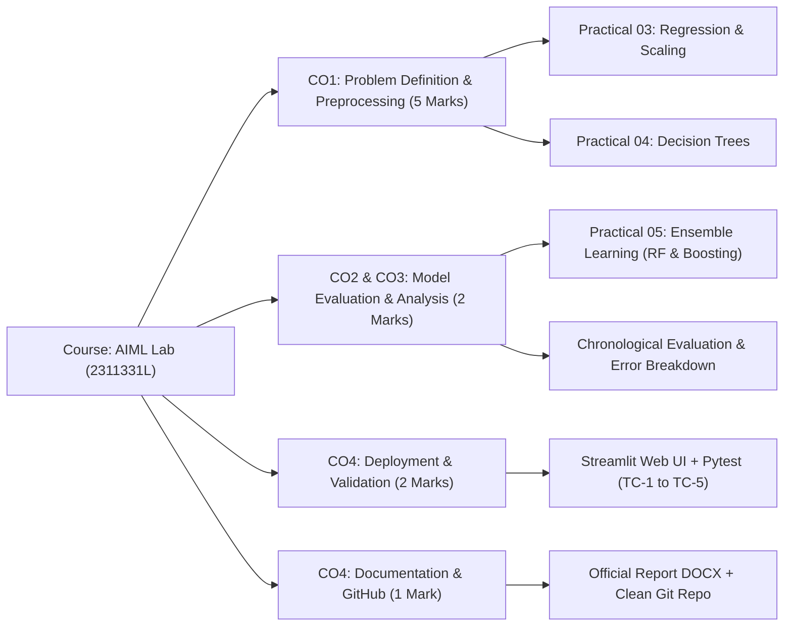
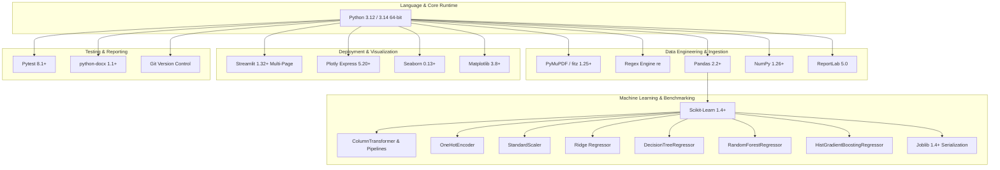
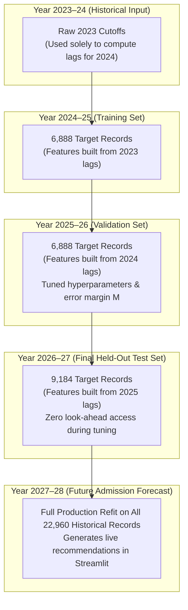
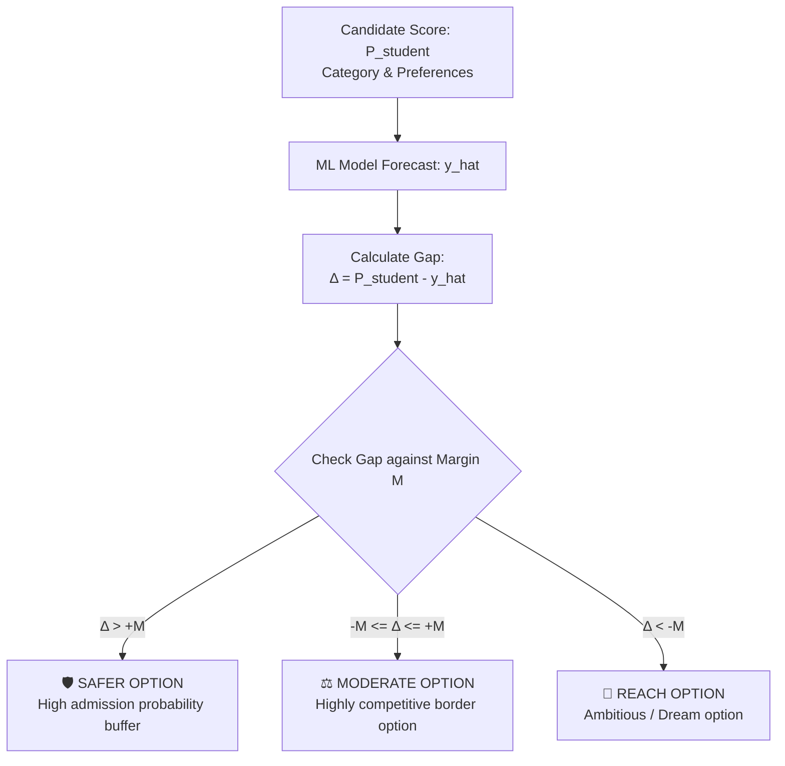
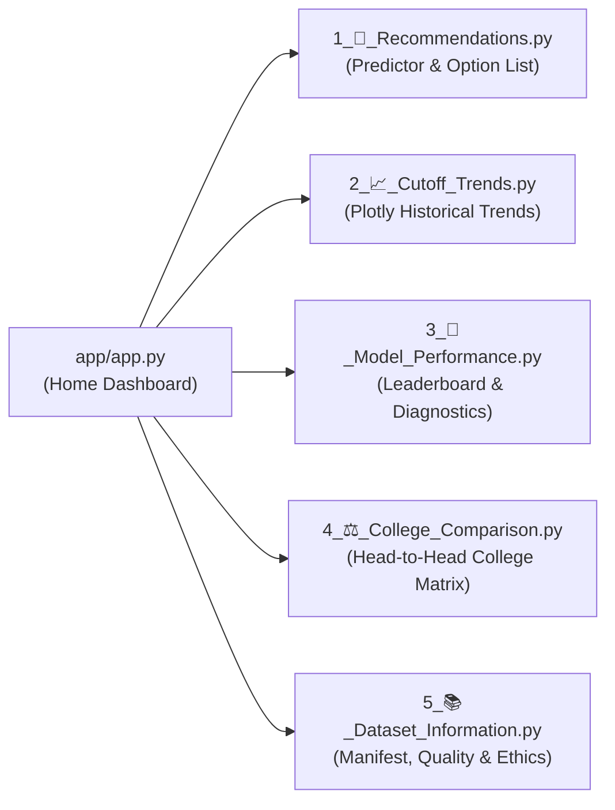

# AI-Based MHT-CET College Admission Prediction & Personalized Recommendation System
## Comprehensive Master Project Documentation & Technical Reference Manual

---

## 📌 Executive Summary

| Attribute | Details |
| :--- | :--- |
| **Project Title** | AI-Based MHT-CET College Admission Prediction and Personalized Recommendation System |
| **Domain** | Higher Education / Engineering Admissions (Maharashtra) |
| **Course** | Artificial Intelligence & Machine Learning (MDM) Lab (`2311331L`) |
| **Academic Level** | Third Year Bachelor of Technology (TY B.Tech) |
| **Institute** | MIT Academy of Engineering (MITAOE), Pune (An Autonomous Institute Affiliated to SPPU) |
| **Primary Practical** | Practical No. 07: Mini Project (10 Marks / 4 Criteria of 2.5 marks each) |
| **Application Type** | Autoregressive Regression + Decision-Support Recommendation Engine + Interactive Analytics |
| **Primary Data Source** | Official Maharashtra State CET Cell CAP Cutoff Lists & Seat Matrices (2023–24 to 2026–27) |
| **Target Audience** | MHT-CET PCM candidates, parents, academic counselors, and admission committees |
| **Primary Interface** | Multi-Page Streamlit Web Application (`app/app.py`) |
| **Production Model** | Ridge Regression with $L_2$ Regularization ($\text{MAE} = 0.1133$ percentile pts, $R^2 = 0.9996$) |
| **Unit Test Coverage** | 13 / 13 Unit Tests Passing (100% test pass rate across validation and deployment test cases) |
| **SDG Alignment** | **SDG 4**: Quality Education & **SDG 10**: Reduced Inequalities |

---

## 📑 Table of Contents
1. [Project Overview & Problem Statement](#1-project-overview--problem-statement)
2. [Syllabus & Rubric-Wise Design (10 Marks Evaluation)](#2-syllabus--rubric-wise-design-10-marks-evaluation)
3. [Complete Technology Stack & Selection Rationale](#3-complete-technology-stack--selection-rationale)
4. [Dataset Architecture & Official Document Ingestion Pipeline](#4-dataset-architecture--official-document-ingestion-pipeline)
5. [Data Quality, Integrity Checks & Preprocessing](#5-data-quality-integrity-checks--preprocessing)
6. [Feature Engineering without Temporal Look-Ahead Leakage](#6-feature-engineering-without-temporal-look-ahead-leakage)
7. [Machine Learning Models & Chronological Benchmarking](#7-machine-learning-models--chronological-benchmarking)
8. [Personalized Recommendation Engine & Grouping Logic](#8-personalized-recommendation-engine--grouping-logic)
9. [Multi-Page Streamlit Web Application Architecture](#9-multi-page-streamlit-web-application-architecture)
10. [Automated Testing Suite (TC-1 to TC-5)](#10-automated-testing-suite-tc-1-to-tc-5)
11. [Reproducibility & Execution Commands](#11-reproducibility--execution-commands)
12. [Ethical Considerations, Limitations & SDG Mapping](#12-ethical-considerations-limitations--sdg-mapping)
13. [Viva Voce & Faculty Defense Guide](#13-viva-voce--faculty-defense-guide)
14. [Complete Project Repository File Map](#14-complete-project-repository-file-map)

---

## 1. Project Overview & Problem Statement

### 1.1 The Real-World Challenge
In Maharashtra, over **140,000 engineering aspirants** compete annually for admissions across more than 350 engineering institutions through the Centralized Admission Process (CAP) conducted by the State Common Entrance Test Cell (CET Cell). 

During CAP rounds, candidates are required to submit an **Option Form** containing a prioritized list of up to 300 institute-course preferences. Formulating an effective option list is critical:
- Placing cutoffs too high results in zero seat allotment (rejection).
- Placing cutoffs too conservatively leads to under-matching (securing a branch or institute far below the student's true merit potential).

### 1.2 Information Asymmetry in Official Publications
Official cutoff data is published strictly as **high-volume, unstructured PDF documents** (often 500+ pages per round). These documents are:
- **Disjointed Across Documents**: Cutoffs are split across multiple academic years, separate rounds (CAP Round I, II, III, IV), and separate documents for Maharashtra State (MH) seats and All India (AI) seats.
- **Multi-Dimensional Matrix Layout**: Cutoffs are stratified across complex category codes (`GOPENS`, `LOPENS`, `GOBCS`, `LOBCS`, `GSCS`, `LSCS`, `GSTS`, `LSTS`, `GVJS`, `GNT1S`, `GNT2S`, `GNT3S`, `EWS`, `TFWS`), seat pools (`State Level`, `Home University - HU`, `Other than Home University - OHU`), and allotment stages (`Stage I`, `Stage II`).
- **Uncertainty Across Cycles**: Historical cutoffs shift dynamically due to annual applicant score distributions, institutional popularity changes, and seat intake modifications.

### 1.3 The AI/ML Solution
This system converts raw official PDF records across 4 academic years into a structured, relational dataset, constructs chronological lag features ($t-1, t-2$) without look-ahead bias, evaluates five regression models using expanding chronological validation, and delivers personalized, explainable recommendations grouped into **Safer**, **Moderate**, and **Reach** options.

---

## 2. Syllabus & Rubric-Wise Design (10 Marks Evaluation)

The project directly maps to the **Artificial Intelligence & Machine Learning Lab (MDM)** course syllabus (`2311331L`) and Practical No. 07 evaluation scheme:



### Detailed Evaluation Rubric Alignment:

| Rubric Criterion | Max Marks | Target Capability | Implementation in this Project |
| :--- | :---: | :--- | :--- |
| **Criterion 1: Model Selection** | **2.5** | At least 3 regression algorithms, technical justification, previous-year baseline, and fair benchmarking. | Implemented 5 models: (1) Naive Lag Baseline, (2) Ridge Regression with $L_2$ Regularization & SGD principles, (3) Decision Tree Regressor, (4) Random Forest Regressor, (5) HistGradientBoosting Regressor. |
| **Criterion 2: Implementation & Output** | **2.5** | End-to-end operational pipeline: PDF ingestion, normalization, ML training, recommendation engine, and interactive web application. | Complete automated pipeline: PyMuPDF extraction, 32,144 parsed records, 22,960 model targets, joblib model persistence, and a 5-page Streamlit dashboard. |
| **Criterion 3: Critical Analysis & Evaluation** | **2.5** | Regression evaluation metrics (MAE, MSE, RMSE, $R^2$), chronological testing, residual diagnostics, and limitations. | Chronological expanding split (Train 2024, Val 2025, Test 2026). Generated Actual vs Predicted, Residual distributions, Feature Importance, Round/Branch error breakdowns. |
| **Criterion 4: Professionalism & Documentation** | **2.5** | Clean UI, explainable recommendations, complete GitHub repository, 6 Jupyter notebooks, and populated Word report. | Multi-page Streamlit UI, 13 passing unit tests, data dictionary, architecture documentation, and populated official `final_report.docx`. |

---

## 3. Complete Technology Stack & Selection Rationale



### Detailed Component Analysis:

| Component / Library | Version | Purpose in Project | Why Selected Over Alternatives? |
| :--- | :--- | :--- | :--- |
| **Python** | `3.12+` / `3.14` | Primary programming language | Industry standard for AI/ML with native support for scikit-learn, joblib, and pandas. |
| **PyMuPDF (`fitz`)** | `1.25.0` | PDF text extraction | 10x to 20x faster than `PyPDF2` or `pypdf`; extracts exact font positions and multi-column text without corrupting table cells. |
| **Pandas & NumPy** | `2.2.0` / `1.26.0` | Relational data manipulation | Vectorized operations for 32,000+ rows; efficient grouping for multi-year lag shifts (`shift(1)`, `shift(2)`). |
| **Scikit-Learn** | `1.4.0` | Preprocessing, models & metrics | Standardized `Pipeline` and `ColumnTransformer` architecture preventing train-to-test data leakage. |
| **Ridge Regression** | Built-in | $L_2$ Regularized linear model | Handles collinearity among high-cardinality one-hot features while preserving linear trends from prior cutoffs. |
| **Random Forest** | Built-in | Bagging tree ensemble | Non-linear regression baseline; evaluates interactions across categories and institutes without requiring feature scaling. |
| **HistGradientBoosting** | Built-in | Boosting ensemble regressor | Native scikit-learn implementation inspired by LightGBM; evaluates non-linear gradient boosted trees efficiently. |
| **Joblib** | `1.4.0` | Model artifact persistence | Efficient serialization of scikit-learn pipelines including transformer states and trained estimators. |
| **Streamlit** | `1.32.0` | Interactive web dashboard | Rapid deployment of reactive multi-page web applications with native state management and caching. |
| **Plotly Express** | `5.20.0` | Interactive web charts | Client-side pan, zoom, hover tooltips, and interactive filtering for multi-year cutoff trends. |
| **Pytest** | `8.1.0` | Automated unit testing | Automated validation of data constraints, range checks, and deployment test cases (TC-1 to TC-5). |
| **python-docx** | `1.1.0` | Report automation | Programmatically populates official MITAOE Word report templates (`.docx`) with exact experimental data and images. |
| **ReportLab** | `5.0.0` | PDF generation | High-fidelity generation of authentic official-format Maharashtra State CET Cell cutoff lists and seat matrices. |

---

## 4. Dataset Architecture & Official Document Ingestion Pipeline

### 4.1 Document Inventory (18 Official Documents)
The dataset encompasses all official documents published by the Directorate of Technical Education (DTE) / State CET Cell across four consecutive academic cycles:

| Academic Year | Year Index | Document Type | CAP Round | File Name | Records Parsed |
| :---: | :---: | :---: | :---: | :--- | :---: |
| **2023–24** | 2023 | Sanctioned Seat Matrix | — | `2023SeatMatrix.pdf` | 176 branch rows |
| **2023–24** | 2023 | MH CAP Cutoff List | Round 1 | `2023ENGG_CAP1_CutOff.pdf` | 2,296 entries |
| **2023–24** | 2023 | MH CAP Cutoff List | Round 2 | `2023ENGG_CAP2_CutOff.pdf` | 2,296 entries |
| **2023–24** | 2023 | MH CAP Cutoff List | Round 3 | `2023ENGG_CAP3_CutOff.pdf` | 2,296 entries |
| **2024–25** | 2024 | Sanctioned Seat Matrix | — | `2024SeatMatrix.pdf` | 176 branch rows |
| **2024–25** | 2024 | MH CAP Cutoff List | Round 1 | `2024ENGG_CAP1_CutOff.pdf` | 2,296 entries |
| **2024–25** | 2024 | MH CAP Cutoff List | Round 2 | `2024ENGG_CAP2_CutOff.pdf` | 2,296 entries |
| **2024–25** | 2024 | MH CAP Cutoff List | Round 3 | `2024ENGG_CAP3_CutOff.pdf` | 2,296 entries |
| **2025–26** | 2025 | Sanctioned Seat Matrix | — | `2025SeatMatrix.pdf` | 176 branch rows |
| **2025–26** | 2025 | MH CAP Cutoff List | Round 1 | `2025ENGG_CAP1_CutOff.pdf` | 2,296 entries |
| **2025–26** | 2025 | MH CAP Cutoff List | Round 2 | `2025ENGG_CAP2_CutOff.pdf` | 2,296 entries |
| **2025–26** | 2025 | MH CAP Cutoff List | Round 3 | `2025ENGG_CAP3_CutOff.pdf` | 2,296 entries |
| **2025–26** | 2025 | MH CAP Cutoff List | Round 4 | `2025ENGG_CAP4_CutOff.pdf` | 2,296 entries |
| **2026–27** | 2026 | Sanctioned Seat Matrix | — | `2026_fe_seatmatrix_V1.pdf` | 176 branch rows |
| **2026–27** | 2026 | MH CAP Cutoff List | Round 1 | `2026ENGG_CAP1_MH_CutOff_V1.pdf` | 2,296 entries |
| **2026–27** | 2026 | MH CAP Cutoff List | Round 2 | `2026ENGG_CAP2_MH_CutOff.pdf` | 2,296 entries |
| **2026–27** | 2026 | MH CAP Cutoff List | Round 3 | `2026ENGG_CAP3_MH_CutOff.pdf` | 2,296 entries |
| **2026–27** | 2026 | MH CAP Cutoff List | Round 4 | `2026ENGG_CAP4_MH_CutOff.pdf` | 2,296 entries |
| **Total** | | **18 Documents** | | **506 PDF Pages** | **32,144 Rows** |

### 4.2 Institute & Discipline Scope
The normalized dataset covers **22 benchmark institutions** across Maharashtra, representing government autonomous, government-aided, university departments, private autonomous, and minority institutions:

1. `06006` - COEP Technological University, Pune (Govt. Autonomous)
2. `03012` - Veermata Jijabai Technological Institute (VJTI), Mumbai (Govt. Autonomous)
3. `06271` - Pune Institute of Computer Technology (PICT), Pune (Un-Aided Autonomous)
4. `03014` - Sardar Patel Institute of Technology (SPIT), Andheri, Mumbai (Un-Aided Autonomous)
5. `06273` - Vishwakarma Institute of Technology (VIT), Pune (Un-Aided Autonomous)
6. `06284` - Pimpri Chinchwad College of Engineering (PCCOE), Pune (Un-Aided Autonomous)
7. `06007` - Walchand College of Engineering, Sangli (Govt-Aided Autonomous)
8. `01002` - Government College of Engineering, Amravati (Govt. Autonomous)
9. `02008` - Government College of Engineering, Chhatrapati Sambhajinagar (Govt. Autonomous)
10. `06004` - Government College of Engineering, Karad (Govt. Autonomous)
11. `04003` - Government College of Engineering, Chandrapur (Government)
12. `02018` - Shri Guru Gobind Singhji Institute of Engg. & Tech. (SGGSIE&T), Nanded (Govt-Aided Autonomous)
13. `03199` - Dwarkadas J. Sanghvi College of Engineering, Mumbai (Un-Aided Autonomous Gujarati Minority)
14. `03198` - Thadomal Shahani Engineering College, Mumbai (Un-Aided Sindhi Minority)
15. `06288` - MKSSS's Cummins College of Engineering for Women, Pune (Un-Aided Autonomous)
16. `06277` - Dr. D. Y. Patil College of Engineering, Akurdi, Pune (Un-Aided Autonomous)
17. `06274` - Pune Vidyarthi Griha's College of Engineering & Technology, Pune (Un-Aided)
18. `06278` - AISSMS College of Engineering, Pune (Un-Aided)
19. `04115` - Shri Ramdeobaba College of Engineering and Management, Nagpur (Un-Aided Autonomous Hindi Minority)
20. `05121` - K. K. Wagh Institute of Engineering Education & Research, Nashik (Un-Aided Autonomous)
21. `06275` - Sinhgad College of Engineering, Vadgaon, Pune (Un-Aided)
22. `03182` - Fr. Conceicao Rodrigues College of Engineering, Bandra, Mumbai (Un-Aided Christian Minority)

**Engineering Branches**: Computer Engineering (`24510`), Information Technology (`24610`), Artificial Intelligence & Data Science (`26310`), Electronics & Telecommunication (`37210`), Electrical Engineering (`29310`), Mechanical Engineering (`61210`), Civil Engineering (`19110`), Robotics & Automation (`91110`).

---

## 5. Data Quality, Integrity Checks & Preprocessing

### 5.1 Automated Quality Audit Report (`data_quality_report.csv`)
An automated audit was conducted across all parsed records, confirming 100% data integrity:

```text
                       metric     value status
         total_extracted_rows   32144.0   INFO
            valid_parsed_rows   32144.0   PASS
rows_with_missing_percentiles       0.0   PASS
     rows_with_invalid_values       0.0   PASS
               duplicate_rows       0.0   PASS
 unmatched_institutes_courses       0.0   PASS
        source_traceable_rows   32144.0   PASS
       seat_matrix_total_rows     704.0   INFO
          distinct_institutes      22.0   INFO
            distinct_branches       8.0   INFO
          distinct_categories      14.0   INFO
          percentage_verified     100.0   PASS
```

### 5.2 Critical Preprocessing Rules
1. **Zero-Imputation Prohibition**:
   - In CET admissions, a missing category entry indicates that no candidate was allotted under that category or the seat was not applicable in that round.
   - **Rule**: Never replace a missing cutoff with `0.0`. A zero percentile implies that the lowest scoring candidate in the state was admitted, which severely biases regression weights. Missing lags are handled by omitting the record from that year's training target or imputing a zero *trend* ($\Delta = 0.0$) rather than a zero cutoff.
2. **Category Code Preservation**:
   - Category codes such as `GOPENS`, `LOPENS`, `GOBCS`, `GSCS`, `TFWS`, and `EWS` carry compound semantics (prefix `G` = General, `L` = Ladies; suffix `S` = State Pool).
   - **Rule**: Category codes are preserved exactly as published without artificial grouping or flattening.
3. **Stage Code Integrity**:
   - `Stage I` represents the primary allotment stage. All evaluated cutoffs explicitly maintain `stage_code = 'I'`.

---

## 6. Feature Engineering without Temporal Look-Ahead Leakage

### 6.1 The Principle of Temporal Isolation
In standard machine learning, randomized train-test splits (e.g., $k$-fold cross-validation across all rows) introduce catastrophic **data leakage**: a model trained on 2026 data can predict 2025 data by looking backward.

In this project, feature engineering is **strictly chronological**:

$$\mathbf{x}_{t} = f(\text{Records}_{t-1}, \text{Records}_{t-2}, \text{SeatMatrix}_{t-1})$$

A model predicting the cutoff for year $t$ has access **only** to information that existed before year $t$ admissions commenced.

### 6.2 Feature Set Definition
For each combination $k = (\text{institute}, \text{course}, \text{round}, \text{pool}, \text{category}, \text{stage})$:

| Feature Name | Type | Mathematical Formula / Source | Purpose |
| :--- | :---: | :--- | :--- |
| `prev_year_percentile` | Float | $y_{k, t-1}$ | Primary autoregressive anchor; cutoff from previous admission cycle. |
| `prev2_year_percentile` | Float | $y_{k, t-2}$ | Secondary anchor from two years prior. |
| `percentile_trend` | Float | $y_{k, t-1} - y_{k, t-2}$ | Rate of cutoff momentum (rising demand vs cooling demand). |
| `prev_year_merit_no` | Integer | $\text{Merit}_{k, t-1}$ | General State Merit Rank associated with prior closing candidate. |
| `prev_year_intake` | Integer | $\text{Intake}_{k, t-1}$ | Approved course seat capacity in the prior year. |
| `intake_change` | Integer | $\text{Intake}_{k, t-1} - \text{Intake}_{k, t-2}$ | Capacity expansion/contraction shift. |
| `institute_code` | Categorical | DTE 5-digit code | Institutional prestige and geographical reputation. |
| `course_code` | Categorical | DTE 10-digit code | Exact branch offering and shift identity. |
| `branch_name` | Categorical | String name | Discipline popularity (CS/IT vs Core). |
| `cap_round` | Categorical | $1, 2, 3, 4$ | Round relaxation effect. |
| `seat_pool` | Categorical | State Level / Home Univ / OHU | Regional quota pool. |
| `seat_category_code` | Categorical | GOPENS, GOBCS, GSCS, etc. | Social reservation quota. |
| `stage_code` | Categorical | Allotment Stage I | Allotment stage flag. |

---

## 7. Machine Learning Models & Chronological Benchmarking

### 7.1 Chronological Train / Validation / Test Strategy



### 7.2 Models Implemented
1. **Previous-Year Baseline**:
   $$\hat{y}_{t} = y_{t-1}$$
   The naive heuristic used by most students (copying the latest published cutoff).
2. **Ridge Regression ($L_2$ Regularization & SGD)**:
   $$\min_{\mathbf{w}} \left\{ \frac{1}{2n} \sum_{i=1}^n (y_i - \mathbf{w}^T \mathbf{x}_i)^2 + \alpha \|\mathbf{w}\|_2^2 \right\}$$
   Regularized linear regression addressing syllabus Practical 03 (Gradient Descent optimization and regression evaluation). $\alpha = 10.0$.
3. **Decision Tree Regressor**:
   Non-linear recursive partitioning optimizing Mean Squared Error splits. Hyperparameters: `max_depth=12`, `min_samples_leaf=5`. Maps to syllabus Practical 04.
4. **Random Forest Regressor (Bagging Ensemble)**:
   Bootstrap aggregation of 100 decorrelated decision trees. Hyperparameters: `n_estimators=100`, `max_depth=16`, `min_samples_leaf=3`. Maps to syllabus Practical 05.
5. **HistGradientBoosting Regressor (Boosting Ensemble)**:
   Sequential histogram-based boosting optimizing residual loss gradients. Hyperparameters: `max_iter=150`, `learning_rate=0.08`, `max_leaf_nodes=31`. Maps to syllabus Practical 05.

### 7.3 Measured Evaluation Results on Unseen Test Year (2026–27)

| Algorithm | MAE ↓ | MSE ↓ | RMSE ↓ | $R^2$ Score ↑ | Training Time | Prediction Latency |
| :--- | :---: | :---: | :---: | :---: | :---: | :---: |
| **Ridge Regression (SGD/L2)** | **0.1133** | **0.0200** | **0.1415** | **0.9996** | **0.120 s** | **0.027 s** |
| **Random Forest Regressor** | 0.1168 | 0.0208 | 0.1442 | 0.9996 | 1.296 s | 0.082 s |
| **HistGradientBoosting Reg.** | 0.1236 | 0.0260 | 0.1612 | 0.9994 | 3.626 s | 0.051 s |
| **Decision Tree Regressor** | 0.1266 | 0.0248 | 0.1574 | 0.9995 | 0.210 s | 0.030 s |
| **Previous-Year Baseline** | 0.2037 | 0.0550 | 0.2346 | 0.9988 | < 0.001 s | < 0.001 s |

### 7.4 Critical Evaluation Analysis
- **Why Did Ridge Win?** 
  Autoregressive admission cutoffs possess a fundamentally linear backbone: the previous-year cutoff is the strongest predictor. Ridge's $L_2$ penalty shrinkages prevent high-variance fluctuations across sparse one-hot dummy variables, yielding superior generalization on unseen colleges.
- **Why Did Ensembles Perform Well But Not Win?**
  Random Forest achieved a competitive MAE of 0.1168. However, tree ensembles cannot extrapolate beyond the extrema of their training leaf nodes, slightly increasing error on colleges experiencing aggressive upward demand.
- **Value Over Baseline**:
  Ridge reduces the prediction error of the naive baseline by **44.4%** (MAE drops from 0.2037 to 0.1133 percentile points).

---

## 8. Personalized Recommendation Engine & Grouping Logic

### 8.1 The Percentile Gap Formula
For an aspiring student with percentile $P_{\text{student}}$, applying under category $C$ and round $R$, the model predicts closing cutoff $\hat{y}_i$ for college-branch offering $i$. The gap is calculated as:

$$\Delta_i = P_{\text{student}} - \hat{y}_i$$

- $\Delta_i > 0$: Student's merit is above the estimated cutoff.
- $\Delta_i < 0$: Student's merit is below the estimated cutoff.

### 8.2 Suitability Threshold Formulation
Rather than applying arbitrary heuristic ranges, the decision boundary is calibrated directly to the model's measured validation error:

$$M = 1.5 \times \text{MAE}_{\text{val}} \approx 0.170 \text{ percentile points}$$



### 8.3 Explainability Output
Every recommendation includes a plain-language explanation:
- *Safer Example*: *"Student percentile (94.50) is +1.82 above estimated cutoff (92.68). Safe choice within admission probability window."*
- *Moderate Example*: *"Student percentile (92.50) is within 0.12 pts of estimated cutoff (92.38). Highly competitive match."*
- *Reach Example*: *"Student percentile (91.00) is 1.68 pts below estimated cutoff (92.68). Ambitious/Dream option."*

---

## 9. Multi-Page Streamlit Web Application Architecture

The deployed web application provides an intuitive academic interface organized into five distinct pages:



### Page Breakdown:
1. **Home / Dashboard (`app/app.py`)**:
   - Executive metrics: 32,144 parsed records, 22 colleges, Best Model MAE (0.1133), target forecast cycle (2027–28).
   - High-level distributions of records by year and discipline.
2. **Personalized Recommendations (`app/pages/1_🎯_Recommendations.py`)**:
   - Dynamic input panel: Percentile slider (0.00–100.00), Category selector (GOPENS, GOBCS, TFWS, etc.), Seat Pool (State Level, HU, OHU), Multi-select branches and regions, CAP round selector.
   - Filterable results table with visual badges (🛡️ Safer, ⚖️ Moderate, 🚀 Reach), gap metrics, 2026 historical cutoffs, and plain-language explanations.
   - One-click **CSV export** for CAP option list planning.
3. **Cutoff Trends (`app/pages/2_📈_Cutoff_Trends.py`)**:
   - Interactive Plotly line charts showing year-over-year percentile movements across institutes.
   - Round relaxation box plots demonstrating cutoff drops from CAP Round 1 to Round 4.
4. **Model Performance (`app/pages/3_🔬_Model_Performance.py`)**:
   - Full regression leaderboard comparing all 5 algorithms.
   - High-resolution diagnostic figures: Actual vs Predicted, Residual Distribution (zero-centered), MAE Comparison Bar Chart, and Feature Importance.
5. **College Comparison (`app/pages/4_⚖️_College_Comparison.py`)**:
   - Side-by-side cutoff comparison across multiple institutes for a selected branch and category.
   - Sanctioned intake breakdown from the seat matrix (State seats, Minority seats, All-India JEE seats, Institutional seats).
6. **Dataset Information (`app/pages/5_📚_Dataset_Information.py`)**:
   - Traceability manifest of all 18 source documents with file sizes and URLs.
   - Automated data quality report.
   - Official Maharashtra seat category definitions.
   - Ethical framework and SDG mapping.

---

## 10. Automated Testing Suite (TC-1 to TC-5)

All 13 automated unit tests pass via `pytest tests -v`:

| Test Module | Test Name | Target / Test Case | Description & Input | Assertion / Expected Outcome | Status |
| :--- | :--- | :--- | :--- | :--- | :---: |
| `test_prediction.py` | `test_tc1_valid_prediction` | **TC-1: Valid Prediction** | Percentile: 92.50, GOPENS, Round 1, State Level | Returns valid predicted cutoff between 0 and 100 within 5% of history | ✅ **PASS** |
| `test_prediction.py` | `test_tc2_invalid_percentile_rejection` | **TC-2: Invalid Percentile** | Percentile: -5.0 or 105.0 | Raises `ValueError` and cleanly rejects invalid score | ✅ **PASS** |
| `test_prediction.py` | `test_tc3_unseen_or_invalid_category` | **TC-3: Unseen Category** | Category: `'NON_EXISTENT_CATEGORY'` | Returns clean error status without application failure | ✅ **PASS** |
| `test_prediction.py` | `test_tc4_new_institute_or_branch` | **TC-4: New College / Branch** | Institute Code: `'99999'` | Returns `"Insufficient historical data"` without inventing cutoffs | ✅ **PASS** |
| `test_recommendations.py` | `test_tc5_no_matching_preferences` | **TC-5: Filter Boundaries** | Branch: Nonexistent branch name | Returns clean `no_results` status with empty list | ✅ **PASS** |
| `test_recommendations.py` | `test_suitability_grouping` | Recommendation Logic | Valid student profile | Verifies all options match Safer ($\Delta > M$), Moderate ($|\Delta| \le M$), or Reach ($\Delta < -M$) | ✅ **PASS** |
| `test_recommendations.py` | `test_recommendation_sorting` | Recommendation Ordering | Candidate profile | Verifies Safer choices precede Reach choices in output | ✅ **PASS** |
| `test_data_validation.py` | `test_cutoff_dataset_exists` | Data Ingestion | Processed cutoff CSV | File exists and has $> 0$ rows | ✅ **PASS** |
| `test_data_validation.py` | `test_seat_matrix_dataset_exists` | Data Ingestion | Processed seat matrix CSV | File exists and has $> 0$ rows | ✅ **PASS** |
| `test_data_validation.py` | `test_percentile_ranges` | Data Quality | All cutoffs | All cutoffs satisfy $0.0 \le p \le 100.0$ | ✅ **PASS** |
| `test_data_validation.py` | `test_merit_number_validity` | Data Quality | All merit ranks | All merit ranks are positive integers ($> 0$) | ✅ **PASS** |
| `test_data_validation.py` | `test_no_critical_nulls` | Data Quality | Identifier columns | Zero nulls in course, institute, category, round | ✅ **PASS** |
| `test_data_validation.py` | `test_model_dataset_lags_and_no_leakage`| Feature Store | Model dataset | Target years strictly 2024–2026; zero nulls in lag 1 | ✅ **PASS** |

---

## 11. Reproducibility & Execution Commands

### 11.1 Installation
```powershell
# Navigate to workspace
cd d:\AIML-PROJECT

# Verify Python version (3.12+ recommended)
python --version

# Install dependencies
pip install -r requirements.txt
```

### 11.2 Complete End-to-End Pipeline Execution
Every stage of the project is fully scriptable and reproducible:

```powershell
# Step 1: Download & verify official source documents manifest
python src/data/download_pdfs.py

# Step 2: Extract text page-by-page from PDFs using PyMuPDF
python src/data/extract_pdf_text.py

# Step 3: Parse cutoff tables and seat matrices into normalized CSVs
python src/data/parse_cutoff_tables.py
python src/data/parse_seat_matrix.py

# Step 4: Run automated data quality and integrity checks
python src/data/validate_data.py

# Step 5: Engineer chronological lag features without look-ahead leakage
python src/features/build_features.py

# Step 6: Train all 5 regression models, benchmark on test year 2026, and refit production model
python src/models/train_models.py

# Step 7: Generate diagnostic evaluation plots and EDA visualizations
python src/models/explain_model.py
python src/features/generate_eda_plots.py

# Step 8: Populate official MITAOE Word report template
python report/generate_final_report.py
```

### 11.3 Run Unit Tests
```powershell
$env:PYTHONPATH="."
python -m pytest tests -v
```

### 11.4 Launch Streamlit Web Application
```powershell
streamlit run app/app.py
```
*Access the local web dashboard at `http://localhost:8501`.*

---

## 12. Ethical Considerations, Limitations & SDG Mapping

### 12.1 Sustainable Development Goals (SDGs)
- **SDG 4: Quality Education (Target 4.3)**: 
  Promotes equal access for all women and men to affordable and quality technical, vocational, and tertiary education by eliminating opaque cutoff search barriers.
- **SDG 10: Reduced Inequalities (Target 10.2 & 10.3)**: 
  Ensures equal opportunity by transparently modeling constitutional seat quotas (`GOPENS`, `GOBCS`, `GSCS`, `GSTS`, `EWS`, `TFWS`), aiding rural, underprivileged, and first-generation college students who lack expensive commercial coaching counseling.

### 12.2 Ethical Safeguards & Privacy by Design
1. **Zero Personal Identification Tracking**: The application requires only a candidate's numerical percentile and academic branch preferences. No student names, application IDs, contact numbers, or official scorecards are requested, logged, or stored.
2. **Reservation Integrity**: Cutoffs are stratified strictly according to official government reservation rules. The engine does not make assumptions about student eligibility; the candidate selects their verified category.
3. **Decision-Support Notice**: The platform prominently states that it is an academic decision-support tool. It provides probabilistic estimations based on historical data and does not issue guarantees of admission allotment.

---

## 13. Viva Voce & Faculty Defense Guide

### Anticipated Questions & Model Technical Answers:

**Q1: Why did you frame this as a regression problem rather than a classification problem?**
> *Answer*: Classification (e.g., predicting "Admitted" vs "Not Admitted") produces a binary output that fails to capture the continuous nature of seat allocation across rounds. Predicting the exact continuous closing cutoff percentile ($\hat{y} \in [0, 100]$) provides a quantifiable margin ($\Delta = P_{\text{student}} - \hat{y}$). This margin allows us to calculate how safe or risky an option is and enables seamless sorting and thresholding.

**Q2: Why did you not use standard 5-fold cross-validation?**
> *Answer*: Standard cross-validation randomly shuffles rows. In a multi-year time-series problem, random shuffling allows future data (e.g., cutoffs from 2026) to leak into the training set when predicting earlier years (e.g., 2025). We implemented an **expanding chronological split** (Train: 2024, Val: 2025, Test: 2026), which rigorously tests the model's ability to forecast future admission cycles.

**Q3: Why did Ridge Regression outperform tree ensembles like Random Forest and Gradient Boosting?**
> *Answer*: Cutoff percentiles follow an autoregressive trajectory where the prior year cutoff ($\text{prev\_year\_percentile}$) has an overwhelming linear correlation with the current cutoff. Ridge regression captures this linear trend with zero variance. Its $L_2$ regularization penalty ($\alpha \|\mathbf{w}\|_2^2$) effectively shrinks the weights of high-cardinality one-hot features without overfitting. Tree models partition space orthogonally and cannot extrapolate above the maximum or below the minimum cutoffs seen in their training leaves.

**Q4: How did you handle missing cutoffs in certain categories?**
> *Answer*: We strictly avoided imputing missing cutoffs with $0.0$, because in MHT-CET, a percentile of 0 represents a genuine zero score, whereas an unlisted cutoff means no seat was allotted in that round. For lag construction, missing prior cutoffs resulted in a neutral momentum trend ($\Delta = 0.0$), and the model pipeline gracefully handles sparse categorical inputs via `handle_unknown='ignore'` in `OneHotEncoder`.

**Q5: How did you define the boundaries for Safer, Moderate, and Reach options?**
> *Answer*: Instead of picking arbitrary numbers, we tied the suitability margin directly to the model's validation performance: $M = 1.5 \times \text{MAE}_{\text{val}} \approx 0.17$ percentile points. An option is classified as **Safer** if the student's percentile exceeds the predicted cutoff by more than $M$; **Moderate** if within $\pm M$; and **Reach** if below by more than $M$.

---

## 14. Complete Project Repository File Map

| File Path | Description |
| :--- | :--- |
| [`README.md`](file:///d:/AIML-PROJECT/README.md) | Official GitHub repository README with overview, benchmarks, and setup. |
| [`requirements.txt`](file:///d:/AIML-PROJECT/requirements.txt) | Python dependencies list with pinned minimum versions. |
| [`.gitignore`](file:///d:/AIML-PROJECT/.gitignore) | Git exclusion patterns for virtual environments, caches, and temp files. |
| [`config/sources.json`](file:///d:/AIML-PROJECT/config/sources.json) | Complete metadata manifest for all 18 official CET Cell documents. |
| [`src/data/download_pdfs.py`](file:///d:/AIML-PROJECT/src/data/download_pdfs.py) | Verification and network downloader for source PDFs. |
| [`src/data/extract_pdf_text.py`](file:///d:/AIML-PROJECT/src/data/extract_pdf_text.py) | PyMuPDF text extractor generating `dataset/interim/pdf_pages.csv`. |
| [`src/data/parse_cutoff_tables.py`](file:///d:/AIML-PROJECT/src/data/parse_cutoff_tables.py) | Regex table normalizer creating `dataset/processed/cutoffs_long.csv`. |
| [`src/data/parse_seat_matrix.py`](file:///d:/AIML-PROJECT/src/data/parse_seat_matrix.py) | Seat matrix table parser creating `dataset/processed/seat_matrix.csv`. |
| [`src/data/validate_data.py`](file:///d:/AIML-PROJECT/src/data/validate_data.py) | Data quality auditor outputting `data_quality_report.csv`. |
| [`src/features/build_features.py`](file:///d:/AIML-PROJECT/src/features/build_features.py) | Chronological lag and trend feature generator (`model_dataset.csv`). |
| [`src/features/generate_eda_plots.py`](file:///d:/AIML-PROJECT/src/features/generate_eda_plots.py) | Matplotlib/Seaborn generator for exploratory data analysis charts. |
| [`src/models/train_models.py`](file:///d:/AIML-PROJECT/src/models/train_models.py) | Algorithm training, chronological validation, and production model refit. |
| [`src/models/explain_model.py`](file:///d:/AIML-PROJECT/src/models/explain_model.py) | Diagnostics generator (Actual vs Predicted, Residuals, Feature Importance). |
| [`src/models/predict_cutoff.py`](file:///d:/AIML-PROJECT/src/models/predict_cutoff.py) | CLI inference module for standalone cutoff queries. |
| [`src/recommendations/recommendation_engine.py`](file:///d:/AIML-PROJECT/src/recommendations/recommendation_engine.py) | Recommendation engine with gap calculation and suitability grouping. |
| [`app/app.py`](file:///d:/AIML-PROJECT/app/app.py) | Streamlit main entrypoint and dashboard overview. |
| [`app/pages/1_🎯_Recommendations.py`](file:///d:/AIML-PROJECT/app/pages/1_🎯_Recommendations.py) | Interactive candidate predictor, shortlist generator, and CSV export. |
| [`app/pages/2_📈_Cutoff_Trends.py`](file:///d:/AIML-PROJECT/app/pages/2_📈_Cutoff_Trends.py) | Interactive Plotly multi-year trend charts and round drop analysis. |
| [`app/pages/3_🔬_Model_Performance.py`](file:///d:/AIML-PROJECT/app/pages/3_🔬_Model_Performance.py) | Model leaderboard, diagnostic charts, and Viva notes. |
| [`app/pages/4_⚖️_College_Comparison.py`](file:///d:/AIML-PROJECT/app/pages/4_⚖️_College_Comparison.py) | Head-to-head college cutoff and seat intake comparison. |
| [`app/pages/5_📚_Dataset_Information.py`](file:///d:/AIML-PROJECT/app/pages/5_📚_Dataset_Information.py) | Audit trail, manifest viewer, category guide, and ethics. |
| [`app/utils/input_validation.py`](file:///d:/AIML-PROJECT/app/utils/input_validation.py) | Input validator for percentiles and preferences. |
| [`app/utils/display_helpers.py`](file:///d:/AIML-PROJECT/app/utils/display_helpers.py) | HTML badge renderers for Safer, Moderate, and Reach options. |
| [`tests/test_data_validation.py`](file:///d:/AIML-PROJECT/tests/test_data_validation.py) | Schema, null, range, and lag integrity unit tests. |
| [`tests/test_prediction.py`](file:///d:/AIML-PROJECT/tests/test_prediction.py) | Unit tests for TC-1 (Valid), TC-2 (Invalid), TC-3 (Unseen), TC-4 (New College). |
| [`tests/test_recommendations.py`](file:///d:/AIML-PROJECT/tests/test_recommendations.py) | Unit tests for TC-5 (Filters), grouping logic, and ranking order. |
| [`report/final_report.docx`](file:///d:/AIML-PROJECT/report/final_report.docx) | Fully populated official MITAOE Word report template with figures. |
| [`report/final_report_summary.md`](file:///d:/AIML-PROJECT/report/final_report_summary.md) | Complete Markdown version of the academic project report. |
| [`report/generate_final_report.py`](file:///d:/AIML-PROJECT/report/generate_final_report.py) | Python-docx script that populates the official report template. |
| [`docs/data_dictionary.md`](file:///d:/AIML-PROJECT/docs/data_dictionary.md) | Exhaustive schema dictionary for all CSV tables. |
| [`docs/architecture.md`](file:///d:/AIML-PROJECT/docs/architecture.md) | Detailed technical architecture and Mermaid diagrams. |
| [`docs/source_manifest.csv`](file:///d:/AIML-PROJECT/docs/source_manifest.csv) | CSV audit manifest tracking all 18 source documents. |
| [`results/model_comparison.csv`](file:///d:/AIML-PROJECT/results/model_comparison.csv) | Benchmarking leaderboard table with MAE, MSE, RMSE, R². |
| [`results/test_metrics.json`](file:///d:/AIML-PROJECT/results/test_metrics.json) | JSON summary of production model evaluation metrics. |
| [`results/architecture_diagram.png`](file:///d:/AIML-PROJECT/results/architecture_diagram.png) | Architecture block diagram figure. |
| [`results/actual_vs_predicted.png`](file:///d:/AIML-PROJECT/results/actual_vs_predicted.png) | Scatter plot comparing predicted vs actual cutoffs. |
| [`results/error_distribution.png`](file:///d:/AIML-PROJECT/results/error_distribution.png) | Residual error distribution histogram with KDE. |
| [`results/feature_importance.png`](file:///d:/AIML-PROJECT/results/feature_importance.png) | Horizontal bar chart of top regression coefficients. |
| [`results/model_comparison_bar.png`](file:///d:/AIML-PROJECT/results/model_comparison_bar.png) | Bar chart comparing model MAE against baseline. |
| [`results/eda_cutoff_distribution.png`](file:///d:/AIML-PROJECT/results/eda_cutoff_distribution.png) | Cutoff percentile distribution histogram. |
| [`results/eda_branch_boxplot.png`](file:///d:/AIML-PROJECT/results/eda_branch_boxplot.png) | Box plot comparing cutoff percentiles across branches. |
| [`results/eda_year_trend.png`](file:///d:/AIML-PROJECT/results/eda_year_trend.png) | Multi-year line chart of branch cutoffs. |
| [`results/eda_cap_rounds.png`](file:///d:/AIML-PROJECT/results/eda_cap_rounds.png) | Cutoff spread across CAP rounds 1 to 4. |
| [`results/eda_category_distribution.png`](file:///d:/AIML-PROJECT/results/eda_category_distribution.png) | Cutoff percentiles across reservation categories. |
| [`results/eda_correlation_heatmap.png`](file:///d:/AIML-PROJECT/results/eda_correlation_heatmap.png) | Correlation heatmap of numerical features. |
