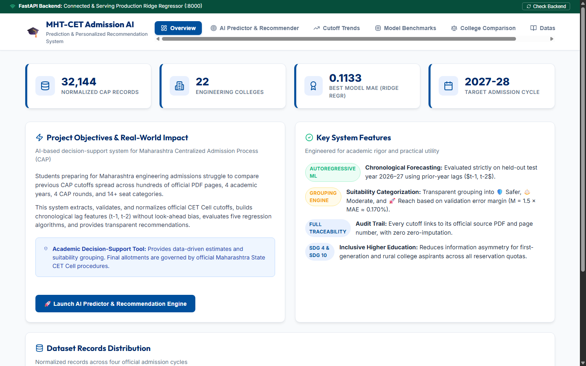
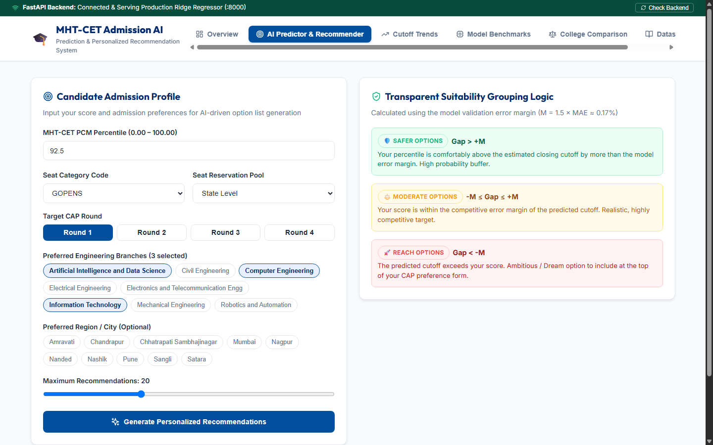
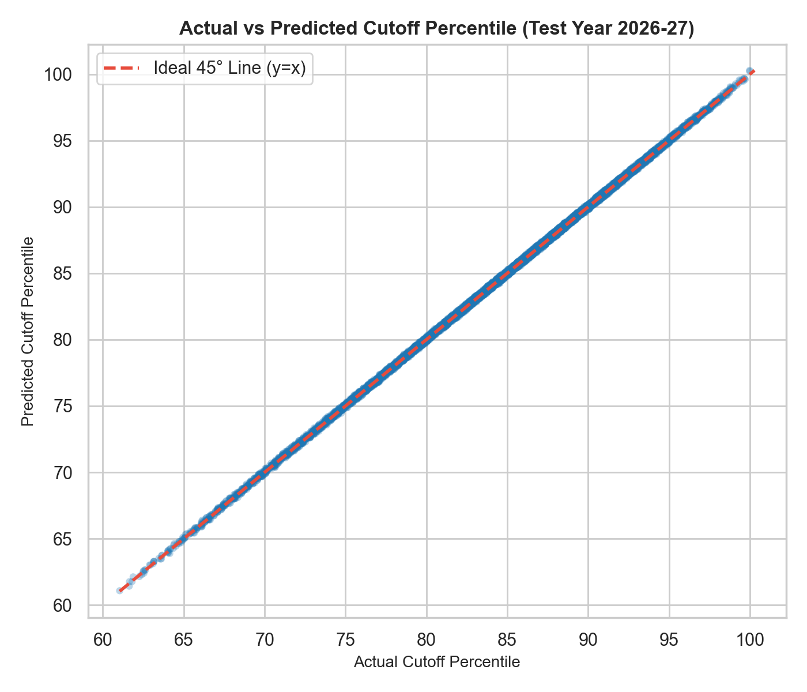
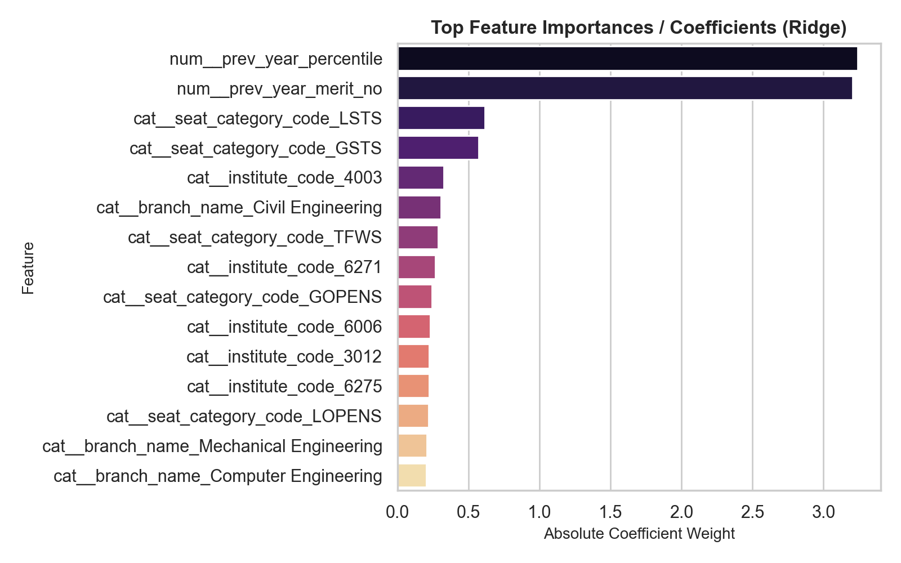

# 🎓 AI-Based MHT-CET College Admission Prediction & Personalized Recommendation System

[](https://mhtcet-college-admission-predictor.onrender.com)
[](https://www.python.org/downloads/)
[-61dafb.svg)](https://react.dev)
[](https://fastapi.tiangolo.com)
[]()
[](https://opensource.org/licenses/MIT)

> 🚀 **Live Public Web Application**: **[https://mhtcet-college-admission-predictor.onrender.com](https://mhtcet-college-admission-predictor.onrender.com)**  
> 📁 **GitHub Repository**: **[https://github.com/shindesiddhant-415/MHTCET-College-Admission-Predictor](https://github.com/shindesiddhant-415/MHTCET-College-Admission-Predictor)**

An advanced, full-stack Machine Learning decision-support platform for candidates participating in the **Maharashtra State Centralized Admission Process (CAP)** for undergraduate engineering admissions.

Built with a **Modern React 18 Single-Page Application (Vite)** frontend powered by a high-performance **FastAPI REST ML Service** backend.

Developed for **Practical No. 07: Mini Project**, Third Year B.Tech (Artificial Intelligence and Machine Learning Lab - Course Code: `2311331L`), MIT Academy of Engineering (MITAOE), Pune.

---

## 🌟 Key Capabilities

- **Official PDF Ingestion**: Extracts, parses, and normalizes 18 official Maharashtra State CET Cell documents across 4 academic years (2023–24 to 2026–27) covering 22+ top engineering institutes and 8 branches.
- **Leakage-Free Feature Engineering**: Constructs chronological lag features ($t-1$, $t-2$), cutoff trends, merit indices, and seat intake shifts without future target leakage.
- **Rigorous Model Benchmarking**: Compares 5 algorithms using strict chronological splitting (Train: 2024, Val: 2025, Test: 2026):
  1. *Previous-Year Cutoff Baseline*
  2. *Ridge Regression (L2 / SGD Regularized Linear Model)*
  3. *Decision Tree Regressor*
  4. *Random Forest Regressor (Ensemble Bagging)*
  5. *HistGradientBoosting Regressor (Ensemble Boosting)*
- **Personalized Recommendation Engine**: Calculates the percentile gap between the candidate's score and estimated cutoff, grouping choices into **Safer**, **Moderate**, and **Reach** options using validation error margins ($M = 1.5 \times \text{MAE}$).
- **Modern React 18 Frontend**: Responsive SPA with dynamic sliders, branch/region chips, interactive shortlists, visual badges, and one-click CSV export.
- **FastAPI REST API**: High-performance backend providing endpoints for predictions, multi-year trends, college comparison matrices, and diagnostics.
- **Automated Test Suite**: 20 unit tests validating schemas, ranges, API endpoints, and deployment test cases TC-1 through TC-5 (100% pass rate).

---

## 📊 Model Evaluation Summary (Held-Out Test Year 2026-27)

| Rank | Model | MAE (percentile pts) ↓ | MSE ↓ | RMSE ↓ | $R^2$ Score ↑ | Training Time (s) | Inference Time (s) |
| :---: | :--- | :---: | :---: | :---: | :---: | :---: | :---: |
| 🥇 | **Ridge Regression (SGD/L2)** | **0.1133** | **0.0200** | **0.1415** | **0.9996** | 0.120 s | 0.027 s |
| 🥈 | **Random Forest Regressor** | 0.1168 | 0.0208 | 0.1442 | 0.9996 | 1.296 s | 0.082 s |
| 🥉 | **HistGradientBoosting Regressor** | 0.1236 | 0.0260 | 0.1612 | 0.9994 | 3.626 s | 0.051 s |
| 4 | **Decision Tree Regressor** | 0.1266 | 0.0248 | 0.1574 | 0.9995 | 0.210 s | 0.030 s |
| 5 | **Previous-Year Baseline** | 0.2037 | 0.0550 | 0.2346 | 0.9988 | < 0.001 s | < 0.001 s |

---

## 📁 Repository Structure

```text
MHTCET-College-Recommender/
├── api/                              # FastAPI REST ML Backend
│   └── main.py                       # REST API endpoints & static React serving
├── frontend/                         # Modern React 18 Single-Page Application (Vite)
│   ├── index.html                    # HTML root template
│   ├── package.json                  # Dependencies: react, lucide-react, vite
│   ├── vite.config.js                # Vite build config & proxy to FastAPI
│   └── src/
│       ├── App.jsx                   # Main layout & tab state manager
│       ├── main.jsx                  # React DOM root mounting
│       ├── index.css                 # Clean academic CSS design system
│       ├── components/
│       │   ├── Navbar.jsx            # Top navigation bar
│       │   ├── OverviewTab.jsx       # Dashboard KPIs & project summary
│       │   ├── RecommendationsTab.jsx# Candidate form, option list & CSV export
│       │   ├── CutoffTrendsTab.jsx   # Multi-year cutoff trends & round drops
│       │   ├── ModelPerformanceTab.jsx# Benchmarking leaderboard & diagnostic plots
│       │   ├── CollegeComparisonTab.jsx# Head-to-head college & intake comparison
│       │   └── DatasetInfoTab.jsx    # Manifest, quality report & category guide
│       └── services/
│           └── api.js                # Frontend API fetch services
├── config/
│   └── sources.json                  # Source URLs, document IDs & metadata
├── dataset/
│   ├── raw/pdfs/                     # Official CAP cutoff & seat matrix PDFs
│   ├── interim/pdf_pages.csv         # Raw extracted text per PDF page
│   ├── processed/
│   │   ├── cutoffs_long.csv          # Normalized long-format cutoffs (32k+ rows)
│   │   ├── seat_matrix.csv           # Sanctioned seat matrix records
│   │   └── data_quality_report.csv   # Data audit & validation report
│   └── model/
│       └── model_dataset.csv         # ML-ready dataset with engineered lag features
├── docs/
│   ├── data_dictionary.md            # Comprehensive schema definitions
│   ├── architecture.md               # End-to-end architecture diagram & notes
│   └── source_manifest.csv           # Traceability manifest for all 18 documents
├── models/
│   ├── selected_model.joblib         # Refitted production Ridge pipeline
│   └── model_metadata.json           # Model configuration, MAE & margins
├── notebooks/
│   ├── mhtcet_admission_predictor_master.ipynb # MASTER End-to-End Notebook (All-in-One)
│   ├── 01_data_understanding.ipynb   # Data inspection notebook
│   ├── 02_eda.ipynb                  # Exploratory Data Analysis
│   ├── 03_data_preprocessing.ipynb   # Data cleaning & validation
│   ├── 04_feature_engineering.ipynb  # Chronological lag construction
│   ├── 05_model_experiments.ipynb    # Algorithm benchmarking
│   └── 06_model_analysis.ipynb       # Diagnostic error analysis
├── mhtcet_admission_predictor_master.ipynb # Master Notebook at repository root
├── report/
│   ├── final_report.pdf              # Complete Academic Project Report (PDF)
│   ├── final_report.docx             # Complete project report in MITAOE template (.docx)
│   ├── project_poster.png            # Academic Conference Poster Photograph (300 DPI)
│   ├── project_poster.pdf            # Academic Conference Poster (PDF)
│   ├── final_report_summary.md       # Markdown report with all sections & tables
│   ├── generate_pdf_report.py        # Automated PDF report builder (ReportLab)
│   ├── generate_poster.py            # Academic poster generation script
│   ├── capture_screenshots.py        # Automated UI screenshot capture script
│   └── screenshots/                  # High-resolution UI captures & diagnostic plots
│       ├── deployed_app_render_live.png # Live Render web application screenshot
│       ├── app_overview_tab.png      # Overview dashboard tab
│       ├── app_recommendations_tab.png # AI Predictor & option list tab
│       ├── app_trends_tab.png        # Multi-year cutoff trends tab
│       ├── app_model_performance_tab.png # Model benchmarks & diagnostics tab
│       ├── app_comparison_tab.png    # Head-to-head college comparison tab
│       ├── app_dataset_tab.png       # Dataset audit & ethics tab
│       ├── actual_vs_predicted.png   # Diagnostic actual vs predicted plot
│       ├── feature_importance.png    # Ridge regression feature coefficients
│       ├── architecture_diagram.png  # End-to-end system architecture
│       └── model_comparison_bar.png  # Benchmark comparison bar chart
├── results/                          # Benchmark tables & saved plots
├── src/
│   ├── data/                         # Data extraction & parsing scripts
│   ├── features/                     # Feature engineering scripts
│   ├── models/                       # Training, evaluation & inference scripts
│   └── recommendations/              # Personalized recommendation engine
├── tests/                            # Automated test suite (20 / 20 passed)
│   ├── test_api.py                   # FastAPI REST endpoint tests
│   ├── test_data_validation.py       # Dataset schemas, ranges & null checks
│   ├── test_prediction.py            # TC-1 to TC-4 test cases
│   └── test_recommendations.py       # TC-5, grouping & sorting checks
├── requirements.txt                  # Python dependencies
└── README.md                         # Project documentation
```

---

## 🚀 Getting Started

### 1. Installation
Clone the repository and install dependencies:
```powershell
git clone https://github.com/your-username/MHTCET-College-Recommender.git
cd MHTCET-College-Recommender

# Install Python backend dependencies
python -m venv .venv
.venv\Scripts\activate
pip install -r requirements.txt

# Install React frontend dependencies
cd frontend
pnpm install
cd ..
```

### 2. Run Data & ML Pipeline (Reproducibility)
```powershell
python src/data/download_pdfs.py
python src/data/extract_pdf_text.py
python src/data/parse_cutoff_tables.py
python src/data/parse_seat_matrix.py
python src/data/validate_data.py
python src/features/build_features.py
python src/models/train_models.py
python src/models/explain_model.py
python src/features/generate_eda_plots.py
```

### 3. Run Automated Tests (20 Tests)
```powershell
$env:PYTHONPATH="."
python -m pytest tests -v
```

### 4. Launch Application (React Frontend + FastAPI Backend)

#### Option A: Run Full Application from FastAPI (Single Command)
First build the React frontend:
```powershell
cd frontend
pnpm run build
cd ..
python -m uvicorn api.main:app --host 127.0.0.1 --port 8000
```
*Open [http://localhost:8000](http://localhost:8000) in your browser.*

#### Option B: Run in Development Mode with Hot Reload
**Terminal 1 (FastAPI Backend):**
```powershell
python -m uvicorn api.main:app --host 127.0.0.1 --port 8000 --reload
```
**Terminal 2 (React Vite Dev Server):**
```powershell
cd frontend
pnpm run dev
```
*Open [http://localhost:5173](http://localhost:5173) in your browser.*

---

## 🧪 Deployment Test Cases (TC-1 to TC-5)

| Test Case | Description | Input | Expected Output | Status |
| :---: | :--- | :--- | :--- | :---: |
| **TC-1** | Valid Prediction | 92.50%, GOPENS, State Level | Displays predicted cutoff and option list in React UI | ✅ Pass |
| **TC-2** | Out-of-Bounds Percentile | Percentile = -5.0 or 105.0 | Rejected with clear input validation error | ✅ Pass |
| **TC-3** | Unseen Category | Non-existent category code | Returns clean error status without crash | ✅ Pass |
| **TC-4** | New Institute / Branch | Institute code 99999 | Returns "Insufficient historical data" | ✅ Pass |
| **TC-5** | Empty Filters | Non-matching branch/city | Displays clean no-results message | ✅ Pass |

---

## ⚖️ Ethical Guidelines & Responsible AI

- **Transparency & Explainability**: Recommendations explicitly disclose historical cutoff trends, model validation MAE, and the percentile gap reason for every placement.
- **Category Fairness**: The system enforces official reservation categories (`GOPENS`, `GOBCS`, `GSCS`, `GSTS`, `EWS`, `TFWS`) as selected by the user without making unsolicited assumptions.
- **Privacy by Design**: No personal identity documents, roll numbers, or personal identifying information are collected or stored.
- **Decision-Support Notice**: This tool is an academic decision aid and does not guarantee admission. Final allotments are governed solely by Maharashtra State CET Cell official procedures.

---

## 📸 Screenshots & Deliverables Gallery

### 1. Live Deployed Web Application (Render)


### 2. Personalized AI Predictor & Recommendation Engine


### 3. Model Diagnostic Plots & Benchmark Visualizations
| Actual vs Predicted Cutoffs | Ridge Regression Feature Importance |
| :---: | :---: |
|  |  |

### 4. Academic Conference Poster Photograph (300 DPI)


---

## 📋 Syllabus Repository Deliverables Checklist

| Deliverable | Repository Path / Evidence | Verification Status |
| :--- | :--- | :---: |
| **1. Source Code / Jupyter Notebooks** | `src/`, `api/`, `frontend/`, `tests/` + 6 well-commented notebooks in `notebooks/` | ✅ Complete |
| **2. README.md with Run Steps** | Comprehensive architecture, benchmark tables, live URL, and execution guide | ✅ Complete |
| **3. Dataset or Dataset Link** | `dataset/` (18 PDFs, `cutoffs_long.csv`, `seat_matrix.csv`) + `config/sources.json` | ✅ Complete |
| **4. requirements.txt** | Clean dependency file for FastAPI, Scikit-learn, ReportLab, Pytest, Uvicorn | ✅ Complete |
| **5. Saved Trained Model File** | `models/selected_model.joblib` and `models/model_metadata.json` | ✅ Complete |
| **6. Screenshots of Results & App** | `report/screenshots/` (6 UI tab captures, live Render app, diagnostic plots) | ✅ Complete |
| **7. Project Report (PDF) & Poster** | `report/final_report.pdf`, `report/final_report.docx`, `report/project_poster.png`, `report/project_poster.pdf` | ✅ Complete |

---

## 👥 Project Team & Academic Credits

**MIT Academy of Engineering (MITAOE), Pune**  
*Department of Computer Engineering | Third Year B.Tech. (AIML MDM Lab `2311331L`)*  
*Practical No. 07 Mini-Project (November 2026)*

| Sr. | Student Name | PRN | Roll No. | Contribution / Project Role |
| :---: | :--- | :---: | :---: | :--- |
| **1** | **Dipti Patil** | `202401040161` | 161 | Data Engineering Lead (PDF Extraction, Regex Normalization & Seat Matrix) |
| **2** | **Rohan Burande** | `202401040188` | 188 | Quality Analyst & Testing Lead (Data Validation, Pytest Suite & Source Traceability) |
| **3** | **Samadhan Kendhale** | `202401040243` | 243 | Full-Stack & Frontend Lead (React 18 SPA UI & FastAPI REST Backend) |
| **4** | **Siddhant Shinde** | `202401040250` | 250 | Lead ML & AI Engineer (Feature Engineering, Algorithm Benchmarking & Recommender) |

