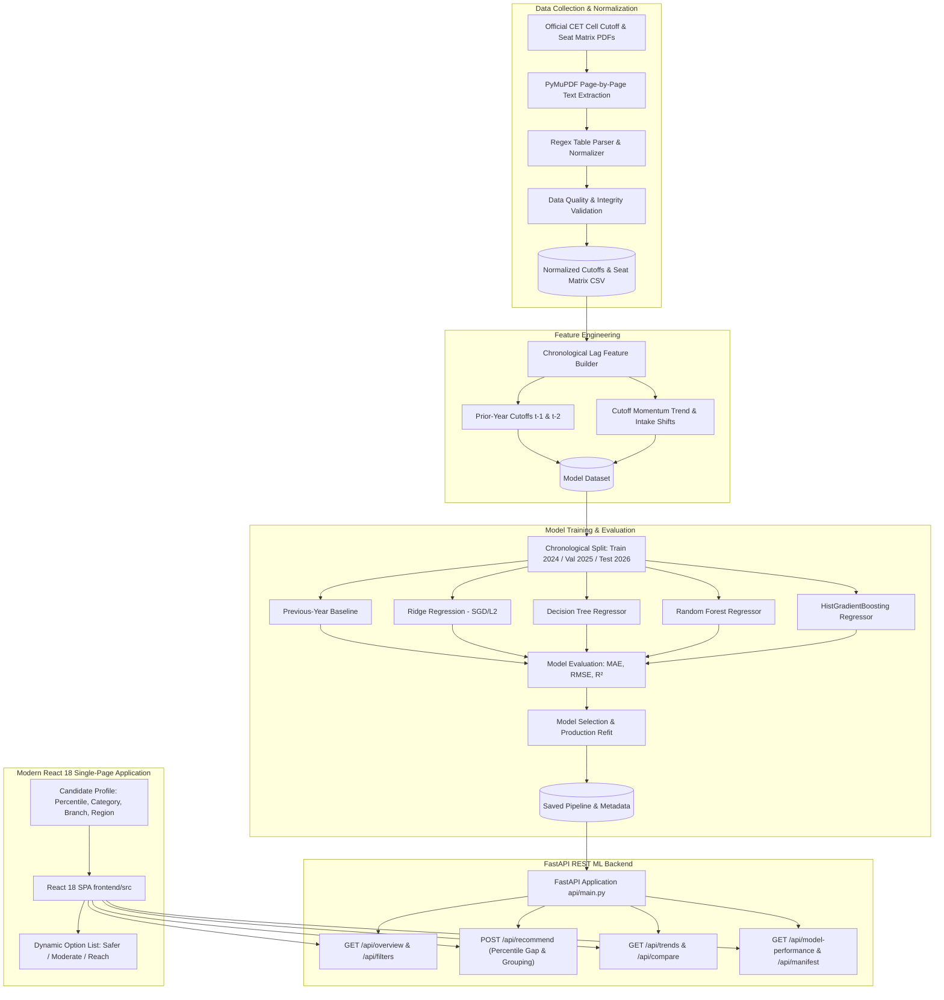

# System Architecture

The **AI-Based MHT-CET College Admission Prediction and Personalized Recommendation System** is built on an end-to-end reproducible machine learning pipeline featuring a modern **React 18 Single-Page Application (Vite)** frontend powered by a high-performance **FastAPI REST ML Service** backend.

---

## 1. Architectural Block Diagram

---

## 2. Chronological Splitting Methodology

Unlike standard randomized splits that cause temporal look-ahead leakage, this system adopts an expanding chronological window:

- **2023–24 (`year_num = 2023`)**: Base historical year used purely to compute initial lag features.
- **2024–25 (`year_num = 2024`)**: Initial training target set ($N = 6,888$).
- **2025–26 (`year_num = 2025`)**: Validation target set ($N = 6,888$) for hyperparameter tuning.
- **2026–27 (`year_num = 2026`)**: Held-out final test set ($N = 9,184$) for model comparison and reporting.
- **2027–28 Forecast**: Final production model refitted on all historical targets ($N = 22,960$) to generate future predictions.

---

## 3. Recommendation Grouping Logic

For every candidate offering $i$:

$$\text{Gap}_i = \text{Percentile}_{\text{Student}} - \hat{y}_i$$

Where $\hat{y}_i$ is the ML predicted closing percentile. Using the validation error margin $M = 1.5 \times \text{MAE}_{\text{val}}$:

- **🛡️ Safer**: $\text{Gap}_i > M$ (Comfortable admission buffer)
- **⚖️ Moderate**: $-M \le \text{Gap}_i \le M$ (Competitive margin)
- **🚀 Reach**: $\text{Gap}_i < -M$ (Ambitious / Dream option)
