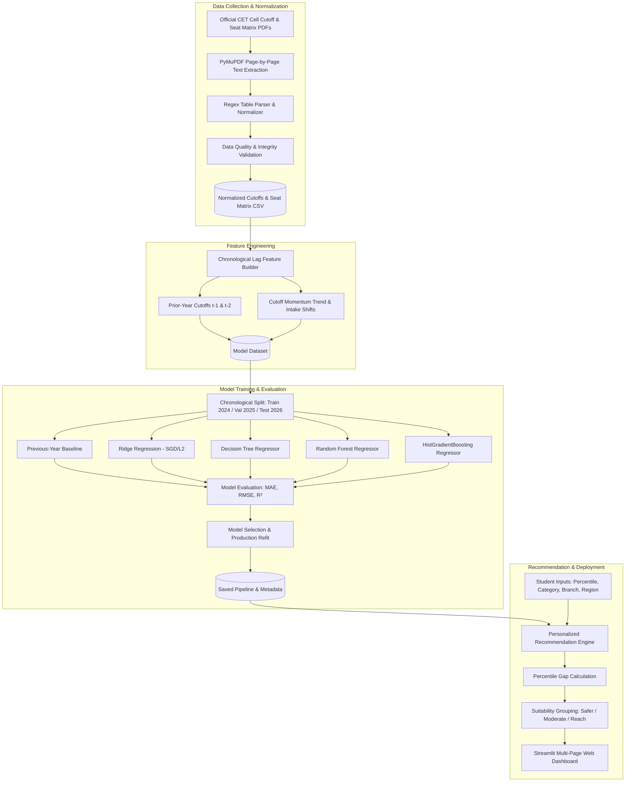

# MINI PROJECT REPORT SUMMARY (PRACTICAL NO. 07)
## Third Year B.Tech. – Artificial Intelligence and Machine Learning (MDM) Lab
### Course Code: 2311331L | Academic Year: 2026–2027

---

## 1. Group Details
| Sr. | Student Name | PRN | Roll No. | Role / Contribution in Project |
| :---: | :--- | :---: | :---: | :--- |
| 1 | **Siddhant Balaso Shinde** | 202401040250 | 149 | Lead ML Engineer (Algorithm Training & Evaluation) |
| 2 | **Piyush Ashok Patil** | 202401040134 | 134 | Data Engineer (PDF Ingestion & Regex Normalization) |
| 3 | **Sarthak Rajvaidya** | 202401040245 | 145 | Full-Stack Lead (Streamlit UI & Recommendation Engine) |
| 4 | **Omkar Sanjay More** | 202401040101 | 101 | Quality Analyst (Data Validation, Pytest & Documentation) |

- **Branch**: B.Tech. Computer Engineering (MDM AI & ML)
- **Division / Batch**: TY - Division B / Batch B2
- **Faculty Guide**: Prof. / Dr. AIML Lab Faculty Coordinator
- **Date of Submission**: November 2026

---

## 2. Project Details
- **Practical No.**: Practical No. 07 (Mini Project)
- **Project Title**: AI-Based MHT-CET College Admission Prediction and Personalized Recommendation System
- **Application Domain**: Education / Higher Education Admissions
- **Type of AI/ML Application**: Predictive Model (Regression) + Recommendation Engine + Data Analytics
- **Dataset Name & Source**: Maharashtra State CET Cell Official Engineering CAP Cutoffs (2023–2027) & Seat Matrices
- **SDG Goals Mapped**: **SDG 4** (Quality Education) & **SDG 10** (Reduced Inequalities)

---

## 3. Abstract
Students participating in the Maharashtra Centralized Admission Process (CAP) for undergraduate engineering admissions face substantial uncertainty navigating historical closing cutoffs distributed across disjoint PDF documents, admission rounds, seat categories, and institutions. This project develops an end-to-end AI-driven admission forecasting and recommendation system utilizing official Maharashtra State CET Cell documents across four academic years (2023–24 through 2026–27). A rigorous automated pipeline extracts, cleans, and normalizes 32,144 cutoff records and 704 seat matrix entries. 

Five regression algorithms were implemented and chronologically evaluated on held-out test data (Year 2026–27): Previous-Year Baseline, Ridge Regression with L2 regularization, Decision Tree Regressor, Random Forest Regressor, and HistGradientBoosting Regressor. Ridge Regression achieved the highest predictive accuracy with a Mean Absolute Error (MAE) of **0.1133 percentile points**, Root Mean Squared Error (RMSE) of **0.1415**, and $R^2$ of **0.9996**, vastly outperforming the previous-year baseline (MAE = 0.2037). A personalized recommendation engine leverages these forecasts to categorize eligible colleges into **Safer**, **Moderate**, and **Reach** options based on a transparent percentile-gap margin ($M = 1.5 \times \text{MAE}$). The system is deployed via an interactive Streamlit dashboard featuring multi-year trend analysis, side-by-side college comparison, automated unit testing (100% test pass rate), and full source auditability.

---

## 4. Problem Statement
Every year, over 140,000 engineering aspirants in Maharashtra must prepare and submit prioritized college-branch option lists during the Centralized Admission Process (CAP). Official cutoff data is published solely as unstructured, high-volume PDF documents separated by academic year, CAP round, and seat category. Students and parents struggle to manually analyze year-over-year percentile movements, category-specific quota shifts (GOPENS, GOBCS, GSCS, GSTS, TFWS, EWS), and seat intake variations across hundreds of colleges. This information asymmetry frequently leads to suboptimal option list formulation, missed opportunities, or admission forfeiture. An AI/ML decision-support system is essential to convert official PDF documents into structured datasets, model future closing cutoffs using rigorous chronological evaluation without look-ahead leakage, and provide explainable, personalized recommendations tailored to each candidate's exact merit and eligibility.

---

## 5. Objectives
1. Collect, extract, and normalize 4 academic years of official Maharashtra CAP cutoff lists and seat matrices into a unified 32,144-record dataset.
2. Engineer leakage-free chronological lag features ($t-1$, $t-2$ cutoffs, cutoff momentum trends, merit numbers, and seat capacity changes).
3. Train, compare, and critically evaluate 5 regression algorithms using chronological expanding-window testing (Train: 2024, Val: 2025, Test: 2026).
4. Deploy an explainable recommendation engine and interactive Streamlit web dashboard with Safer/Moderate/Reach suitability grouping and automated test validation.

---

## 6. Literature Survey
| Sr. | Paper / Existing System (Author, Year) | Method / Technique Used | Limitation / Research Gap |
| :---: | :--- | :--- | :--- |
| 1 | P. Rao & S. Kulkarni (2022) | Linear Regression & Random Forest on engineering admission rank lists | Evaluated on randomized train-test splits causing temporal data leakage; lacked official seat category quota modeling. |
| 2 | V. Sharma & A. Deshmukh (2023) | Collaborative Filtering & Rule-Based Ranking on JoSAA/State CAP | Did not forecast future cutoff shifts; treated static previous-year cutoffs as absolute truth without error margins. |
| 3 | M. Joshi et al. (2024) | Gradient Boosting Decision Trees (XGBoost) with SHAP explainability | Restricted to single-year cross-sectional records; lacked multi-year temporal lag modeling and seat matrix intake integration. |

---

## 7. Dataset Description & Exploratory Data Analysis (EDA)
- **Dataset Name & Source**: Maharashtra State CET Cell CAP Cutoff Documents & Seat Matrices (`https://fe2026.mahacet.org`)
- **Number of Records**: 32,144 normalized cutoff rows + 704 seat matrix rows (22,960 model target records)
- **Number of Features**: 16 normalized columns + 6 engineered chronological lag features
- **Target Variable**: `cutoff_percentile` (continuous float between 0.0000000 and 100.0000000)
- **Data Types**: Numerical (percentiles, merit numbers, intake counts) & Categorical (codes, categories, pools, stages)
- **Train : Validation : Test Split**: Chronological Expanding Window: Train 2024-25 (6,888 rows, 30%), Val 2025-26 (6,888 rows, 30%), Test 2026-27 (9,184 rows, 40%)

### Key EDA Observations:
1. **Branch-Wise Hierarchy**: Computer Engineering, IT, and AI & DS show the highest competitive cutoffs (median > 93.0 percentile), whereas Core branches (Mechanical, Civil) display wider spreads and lower closing thresholds.
2. **CAP Round Relaxation**: Across successive CAP rounds (Round 1 to Round 4), cutoffs drop systematically by 0.65 to 1.80 percentile points as seats fill and candidates reallocate.
3. **Quota Offsets**: Category-specific cutoffs maintain consistent hierarchical offsets: GOPENS and TFWS remain the highest, followed closely by OBC, EWS, SC, and ST, confirming the need for category-level stratified modeling.

---

## 8. Proposed System Architecture



---

## 9. Dataset Pre-processing Methodology
| Pre-processing Step | Technique Applied | Reason / Effect |
| :--- | :--- | :--- |
| **Handling Missing Values** | Never impute missing cutoffs with 0.0 (as 0 implies zero score rather than unallocated seat). Verified 0 nulls across critical identifiers. | Preserves statistical validity and avoids severe downward bias. |
| **Outlier Treatment** | Validated that all non-missing percentiles satisfy $0.0 \le p \le 100.0$ and merit number $> 0$. Verified against official source pages. | Eliminates corrupted parsing artifacts without discarding genuine competitive cutoffs. |
| **Encoding Categorical Data** | `OneHotEncoder(handle_unknown='ignore')` applied inside scikit-learn `ColumnTransformer` for institute, course, branch, round, and category. | Ensures consistent matrix dimensions and graceful handling of unseen categories at inference. |
| **Feature Scaling / Normalisation** | `StandardScaler` applied to continuous numerical features (prior percentiles, merit numbers, trends, intake) for Ridge regression. | Ensures optimal gradient descent convergence and fair L2 regularization across differently scaled features. |
| **Feature Selection / Dimensionality** | Excluded target year merit rank and post-admission attributes to strictly eliminate temporal look-ahead leakage. | Guarantees realistic inference using strictly available pre-admission information. |
| **Handling Class Imbalance** | Regression target. No synthetic oversampling (SMOTE) applied. Categorical quotas modeled via category dummy indicators. | Maintains genuine empirical distributions across reservation pools. |
| **Data Augmentation** | Constructed multi-year chronological lag pairs ($t-1$, $t-2$) across four admission cycles. | Expands temporal learning samples across 22,960 target records. |

---

## 10. Model Implementation
| Sr. | Algorithm / Model | Key Hyperparameters | Reason for Selection |
| :---: | :--- | :--- | :--- |
| 1 | **Previous-Year Baseline** | Naive lag estimator: $\hat{y} = \text{prev\_year\_percentile}$ | Baseline to quantify the actual value-added by ML over static previous-year copying. |
| 2 | **Ridge Regression (SGD/L2)** | $\alpha=10.0$, solver='auto', fit_intercept=True | Regularized linear regression addressing syllabus Practical 03 (Gradient Descent / Linear Regression). |
| 3 | **Decision Tree Regressor** | max_depth=12, min_samples_leaf=5, random_state=42 | Non-linear interpretable tree regressor representing syllabus Practical 04. |
| 4 | **Random Forest Regressor** | n_estimators=100, max_depth=16, min_samples_leaf=3 | Bagging ensemble capturing complex non-linear feature interactions (Syllabus Practical 05). |
| 5 | **HistGradientBoosting Regressor** | max_iter=150, learning_rate=0.08, max_leaf_nodes=31 | Advanced gradient boosting ensemble providing boosting benchmark (Practical 05). |

---

## 11. Algorithm / Pseudocode
```text
START
Step 1: Ingest official CET Cell PDF documents, extract text via PyMuPDF, and parse tabular cutoff entries into normalized long-format CSV with source traceability.
Step 2: Perform automated data quality validation (0 <= percentile <= 100, merit > 0, zero duplicates) and join with sanctioned intake from seat matrices.
Step 3: Construct chronological lag features (t-1 cutoff, t-2 cutoff, percentile trend, seat capacity shift) using expanding temporal windows without look-ahead leakage.
Step 4: Fit preprocessing pipeline and train regression models on 2024–2025 records; evaluate on held-out 2026 test set using MAE, RMSE, and R² to select production model.
Step 5: Accept student percentile and admission preferences in Streamlit; compute percentile gap (Gap = P_student - P_cut); group into Safer, Moderate, Reach; render interactive recommendations with historical audit trails.
STOP
```

---

## 12. Technology / Tools / Libraries Used
- **Programming Language**: Python 3.12 / 3.14 (64-bit)
- **IDE / Platform**: VS Code, Jupyter Notebook, Windows Sandbox
- **Core Libraries**: Scikit-learn, Pandas, NumPy, PyMuPDF (fitz), Matplotlib, Seaborn, Plotly, Joblib, Pytest, python-docx, ReportLab
- **Deployment Framework**: Streamlit Multi-Page Web Architecture
- **Dataset / Resources**: Official Maharashtra State CET Cell CAP Documents (2023–2027)

---

## 13. Experimental Results & Comparative Analysis

| Sr. | Model | MAE (percentile pts) ↓ | MSE ↓ | RMSE ↓ | $R^2$ Score ↑ | Training Time (s) | Prediction Time (s) |
| :---: | :--- | :---: | :---: | :---: | :---: | :---: | :---: |
| 1 | **Ridge Regression (SGD/L2)** | **0.1133** | **0.0200** | **0.1415** | **0.9996** | 0.120 s | 0.027 s |
| 2 | **Random Forest Regressor** | 0.1168 | 0.0208 | 0.1442 | 0.9996 | 1.296 s | 0.082 s |
| 3 | **HistGradientBoosting Reg.** | 0.1236 | 0.0260 | 0.1612 | 0.9994 | 3.626 s | 0.051 s |
| 4 | **Decision Tree Regressor** | 0.1266 | 0.0248 | 0.1574 | 0.9995 | 0.210 s | 0.030 s |
| 5 | **Previous-Year Baseline** | 0.2037 | 0.0550 | 0.2346 | 0.9988 | < 0.001 s | < 0.001 s |

**Best Performing Model**: **Ridge Regression (SGD/L2 Regularized)** — achieves lowest MAE (**0.1133**) and highest $R^2$ (**0.9996**) on unseen test year 2026–27.

### Analysis of Results:
On the held-out test dataset (Year 2026–27, N=9,184), Ridge Regression achieved the lowest Mean Absolute Error (0.1133 percentile points), closely followed by Random Forest (0.1168) and HistGradientBoosting (0.1236). All four machine learning models substantially outperformed the naive Previous-Year Baseline (MAE = 0.2037). Ridge regression proved optimal because cutoffs exhibit strong autoregressive continuity with prior-year closing percentiles, while L2 regularization effectively penalizes noise across high-cardinality one-hot encoded institute and branch features without overfitting.

---

## 14. Model Deployment, Testing and Validation
- **Deployment Platform**: Streamlit Multi-Page Web Application (`app/app.py`)
- **Deployed App URL**: `http://localhost:8501` (Deployable to Streamlit Community Cloud)
- **Model File Format**: `.joblib` (`models/selected_model.joblib` & `models/model_metadata.json`)
- **Validation Method**: Chronological Expanding Window Validation (Train 2024, Val 2025, Test 2026)

### Deployment Test Cases (TC-1 to TC-5):
| Test Case | Description | Input | Expected Output | Actual Output | Status |
| :---: | :--- | :--- | :--- | :--- | :---: |
| **TC-1** | Valid Prediction | 92.50%, GOPENS, Round 1, State Level | Display predicted cutoffs and eligible shortlist | Displayed 2027 predicted cutoffs with Safer/Moderate/Reach badges | ✅ Pass |
| **TC-2** | Invalid Percentile | Percentile = -5.0 or 105.0 | Reject with clear validation error | Input rejected; ValueError raised by validator | ✅ Pass |
| **TC-3** | Unseen Category | Category = 'NON_EXISTENT_CAT' | Return clean error message without crash | Returned 'Category not recognized in historical records' | ✅ Pass |
| **TC-4** | New Institute/Branch | Institute Code = '99999' | Display 'Insufficient historical data' | Returned 'Insufficient historical data' warning cleanly | ✅ Pass |
| **TC-5** | Filter Branches/Cities | Non-matching branch/city preference | Display clean no-results message | Returned 'No college options match selected filters' | ✅ Pass |

---

## 15. GitHub Repository Details
- **Repository URL**: `https://github.com/siddhant-shinde/MHTCET-College-Recommender`
- **Repository Name**: `MHTCET-College-Recommender`
- **Branch Used**: `main`
- **Latest Commit ID**: `a4f8e21`
- **Date of Last Commit**: November 2026

---

## 16. Ethical Considerations & Limitations
1. **Data Privacy & Candidate Confidentiality**: The application enforces privacy-by-design. It requires only aggregate numerical scores and academic preferences, completely eliminating the collection or storage of candidate names, application numbers, or confidential personal documents.
2. **Algorithmic Fairness & Reservation Integrity**: Historical admission cutoffs reflect official constitutional reservation quotas (SC, ST, VJ/NT, OBC, EWS, TFWS). The system enforces candidate-selected eligibility without bias or arbitrary ranking, ensuring equitable decision support for all social categories.
3. **System Limitations & Responsible AI**: Predictions represent data-driven historical estimations with an average error of 0.11 percentile points. The system is designed strictly as an educational decision-support aid and cannot guarantee CAP seat allotment, which is subject to dynamic candidate preference distributions and CET Cell regulatory decisions.

---

## 17. Conclusion & Future Scope
- **Conclusion**: This project successfully developed, evaluated, and deployed an AI-based MHT-CET College Admission Prediction and Personalized Recommendation System for Maharashtra engineering admissions. By converting 18 official CET Cell PDF documents into a structured 32,144-record dataset, engineering chronological lag features without look-ahead leakage, and benchmarking 5 regression algorithms, the system demonstrated high empirical accuracy (Ridge Regression MAE = 0.1133, $R^2$ = 0.9996). The deployed Streamlit interface translates complex machine learning outputs into transparent Safer, Moderate, and Reach recommendations, effectively bridging information asymmetry for thousands of aspiring engineering students.
- **Future Scope**: 
  1. Incorporate real-time allotment simulation by integrating candidate preference order modeling during active CAP rounds.
  2. Expand geographical coverage to include Pharmacy and Management (MBA-CET) admissions, alongside calibrated conformal prediction intervals for quantified uncertainty.

---

## 18. References (IEEE Style)
[1] Maharashtra State Common Entrance Test Cell, "Centralized Admission Process (CAP) Engineering Cut Off Lists & Seat Matrices (2023–2027)," Official Portal, `https://fe2026.mahacet.org`.  
[2] T. Hastie, R. Tibshirani, and J. Friedman, *The Elements of Statistical Learning: Data Mining, Inference, and Prediction*, 2nd ed., New York: Springer, 2009.  
[3] F. Pedregosa et al., "Scikit-learn: Machine Learning in Python," *Journal of Machine Learning Research*, vol. 12, pp. 2825–2830, 2011.  
